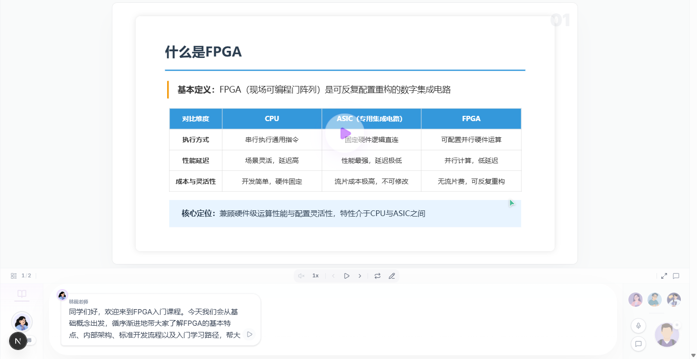

# OpenTeach

**把「一句话生成一整堂多智能体互动课」做成 [DeepSeek Harness](https://github.com/deepseek-ai/deepseek-harness)（dsh）插件。**


输入一个需求 —— 比如「讲一节 FPGA 入门课，面向大二学生」—— 它会依次产出课程大纲、逐页场景、
可翻页的幻灯片、配音语音，然后交付一间**多智能体互动课堂**：AI 教师主讲，助教、笔记员、
「好奇宝宝」等角色实时插话、上台板书、投屏演示，全程可回放、可续传。



这本是 [OpenMAIC](https://github.com/THU-MAIC/OpenMAIC) 独立部署的 Web 站点能力。OpenTeach
把它**重构成可被 dsh 装载与组合的插件**：后端是一个 dsh 插件包，前端复用 OpenMAIC 界面，
模型能力完全沿用宿主配置。

> OpenMAIC 上游是只读参考。本仓库不再维护它，也不与其同步发布节奏。

## 为什么是「插件」而不是又一个部署包

| | 传统做法 | OpenTeach |
| --- | --- | --- |
| 形态 | 独立站点，自带账号/服务/端口 | 一个 dsh 插件包，12 个模块插件在进程内组装 |
| 模型 | 自持 API Key 与 provider 配置 | **完全沿用宿主 `ctx.llm`**：端点、模型目录、凭据都由 dsh 掌管，本包不复制、不落盘任何凭据 |
| 编排 | 自建调度循环 | 复用 dsh 的 `ctx.agents` / `ctx.llm` 编排内核 |
| 缺依赖时 | 直接报错 | **处处可降级**：没有 API Key 走 mock 也跑通全链路；没有 `@openmaic/dsl` 用内置幻灯片生成器；没有知识库就少一路上下文 —— 都不阻断主流程 |
| 卸载 | 残留服务与数据 | Cordis 式 fiber，模块可热插拔，`dispose` 幂等 |

## 核心能力

- **一键生成全链路** —— 需求 → 大纲 → 场景 → 幻灯片 → 语音，五步闭环；可开大纲人工复核。
- **多智能体互动课堂** —— Director 调度 + 子智能体：6 个内置角色（AI 教师 / AI 助教 / 显眼包 /
  好奇宝宝 / 笔记员 / 思考者），各自持有不同的动作权限（白板、聚光灯、激光笔、播放视频），
  事件流经 SSE 推送到前端并支持断线续传。
- **本地知识库（KB）** —— 上传自己的讲义/教材，生成时按 **BM25** 检索并注入大纲。
  存储是**纯文件系统 JSON**（`documents.json` + `chunks.json`），分词为 ASCII 整词 + CJK
  单字/二元组，**零外部依赖、无 embedding、不需要向量数据库**。
- **幻灯片生成** —— 产出符合 `@openmaic/dsl` 契约的场景，前端用 PPTist 画布渲染，可翻页。
- **语音** —— TTS / ASR 走 provider 注册表，按 provider + voice 路由，可只启用其一。
- **联网调研** —— 生成前可做 web search，把检索结果与知识库上下文一起并入大纲。
- **评估中心** —— 对生成结果做指标打分与历史趋势对比。

## 它由什么组成

```
┌─────────────────────────────────────────────────────────────────────┐
│  dsh（DeepSeek Harness）宿主                                         │
│  · ctx.llm / ctx.agents：模型路由、凭据、编排内核                     │
│                                                                     │
│  ┌───────────────────────────────────────────────────────────────┐  │
│  │  @openteach/bundle  （一个 dsh 插件，含 12 个模块插件）         │  │
│  │                                                               │  │
│  │  llm → db → kernel → storage → generation → layout → slide     │  │
│  │       → audio → classroom → openmaic-core → kb → http          │  │
│  │                                                               │  │
│  │  Express 出口 :8787                                            │  │
│  │    · openmaic-core：移植自 OpenMAIC 的 35 条核心 API            │  │
│  │    · /api/kb：本地知识库的索引与检索                            │  │
│  │    · /api/llm /api/classroom /api/agents：教学闭环与课堂编排    │  │
│  │    · 未实现能力域统一 501                                       │  │
│  └───────────────────────────────────────────────────────────────┘  │
└─────────────────────────────────────────────────────────────────────┘
              ▲ /api/*  （Next.js rewrite 同源转发）
┌─────────────┴───────────────────────────────────────────────────────┐
│  @openteach/frontend  （Next.js 前端，移植自 OpenMAIC 前端）          │
│  · workbench / generation-preview / classroom / eval 四个入口         │
│  · 支持 12 种界面语言                                                │
└─────────────────────────────────────────────────────────────────────┘
```

一句话：**后端 = 一个 dsh 插件；前端 = OpenMAIC 前端的改接版。**

## 快速开始

```sh
# 1. 构建后端插件（软链宿主包 → 构建 openmaic-core → 打包 lib/index.js）
cd OpenTeach && bash scripts/build.sh
#    harness checkout 不在仓库内时显式指定（本机：/mnt/e/AgentDev/LuPin/deepseek-harness-master）
#    DSH_CHECKOUT=<harness 路径> bash scripts/build.sh

# 2. 注册为 dsh 插件（用户层，推荐本地迭代）
#    把 OpenTeach/cordis.patch.yml 的 insert 行写入 $DSH_HOME/profiles/<name>/cordis.patch.yml

# 3. 启动宿主（后端随之监听 :8787）
pnpm dsh web
#    注意：Win/Mac 本地开发还需一个 PostgreSQL（容器）陪跑，见 docs/development.md

# 4. 启动前端
cd ../OpenTeach-frontend && pnpm install
$env:OPENTEACH_API_BASE="http://127.0.0.1:8787"   # PowerShell
pnpm dev            # http://localhost:3000
```

自检：`curl http://127.0.0.1:8787/api/llm/providers` 应返回当前默认 provider 与模型（如 `ark-doubao` / `doubao-seed-2-1-pro-260628`）；各 provider 的 `degraded` 为 `false` 即表示未落入 mock 适配器，LLM 真实可用。

> 注意：`/api/health` 实际返回的是 openmaic-core 移植路由的响应，其 `capabilities`（webSearch / imageGeneration / videoGeneration / tts）只反映那四个**可选能力域**是否接入 —— 全为 `false` 属预期，与聊天 LLM 无关，不能据此判断模型是否可用。

完整步骤、数据库与环境变量见 [docs/development.md](docs/development.md)。

## 仓库结构

| 目录 | 内容 |
| --- | --- |
| `OpenTeach/` | **后端**：`@openteach/bundle` —— dsh 插件包，组装 12 个 `@openteach/plugin-*` 模块插件；含随包发布的提示词资产 `assets/` 与单文件产物 `lib/index.js` |
| `OpenTeach-frontend/` | **前端**：`@openteach/frontend` —— Next.js 移植自 OpenMAIC 前端，接口改接 OpenTeach 后端 |
| `docs/` | 技术文档（见下） |
| `references/` | 第三方参考仓库（只读，**不入库**）：`OpenMAIC/`（上游移植来源与 `@openmaic/*` 契约对照）、`deepseek-harness/`（dsh 宿主 checkout，构建期软链 `@deepseek-ai/*`）、`dsh-openmaic/`、`DeepTutor/`、`Edu-RAG/` |

## 技术文档

| 文档 | 内容 |
| --- | --- |
| [docs/architecture.md](docs/architecture.md) | 总体架构：组装模型、插件装配顺序与服务拓扑、双持久化 |
| [docs/llm.md](docs/llm.md) | LLM 接入：宿主优先（方案 B）、`eduLlm` 反向适配、mock 降级 |
| [docs/generation.md](docs/generation.md) | 生成链路：openmaic-core 路由移植、三套提示词资产与注入机制 |
| [docs/classroom.md](docs/classroom.md) | 多智能体课堂：Director / 子智能体、6 个内置角色与权限、事件契约 |
| [docs/frontend.md](docs/frontend.md) | 前端移植与集成：rewrite 代理、501 与入口裁剪、交互 widget 约定 |
| [docs/development.md](docs/development.md) | 开发与部署：构建、注册、启动、配置与环境变量、常见问题 |
| [OpenTeach/packages/kb/DESIGN.md](OpenTeach/packages/kb/DESIGN.md) | 本地知识库设计：存储布局、BM25 检索、HTTP 契约与降级策略 |

## 相对 OpenMAIC 的关键改动

- **形态**：独立站点 → dsh 插件包（单包安装，12 个模块插件进程内组装，可热插拔）。
- **模型**：自持 LLM 配置 → **完全沿用 dsh 宿主**的 `ctx.llm`（provider / 端点 /
  模型 / 凭据都由 dsh 掌管），不自持也不复制凭据。
- **编排**：自建编排 → 复用 dsh 的 `ctx.agents` / `ctx.llm` 编排内核。
- **知识库**：新增独立的 `@openteach/plugin-kb` —— 文件系统 JSON 存储 + BM25 词法检索，
  不引入 embedding 与向量库，通过通用的 `externalContext` 接缝注入生成，内核对其实现无感知。
- **前端**：后端服务端渲染 → Next.js 前端独立运行，`/api/*` 同源转发到后端。
- **降级**：任一能力缺失（无凭据、无 dsl、无内核、无知识库、未实现路由）都不阻断闭环。

## 许可

各子目录保留其原有许可证，详见各目录下的 `LICENSE`。